 

 

Software developer from Rosario, Santa Fe. I build web apps from the React interface down to the database, and I know the network and servers they run on, because I also work as a network infrastructure technician.

I like to understand the problem before writing code, and I try to keep solutions simple and modular. Right now I'm looking for a full-time, on-site role in Rosario (driver's license B1/B2 and own vehicle).

<b>Alasknet</b> · Full Stack Developer & Network Infrastructure Technician · <i>Sep 2026 – now</i>

 

- Develop and maintain web apps and software modules, and support internal platforms with React, PostgreSQL, Docker and GitHub.
- Odoo integrations through XML-RPC / JSON-RPC, and deployment on VPS.
- Setup, monitoring and support of networks (routing, switching, LAN/WAN), servers and hardware.

<b>FIWO Agency</b> · Lead Developer (project-based startup) · <i>Feb 2026 – Jul 2026</i>

 

- Designed and built full stack apps with React and ASP.NET Core (C#), following Clean Architecture.
- Responsive interfaces with Tailwind CSS, REST endpoints and JWT security.
- Data modeling with Entity Framework Core / SQL Server, deployed continuously on Microsoft Azure.

<table>
  <tr>
    <td width="50%" valign="top">
       
      AI agent connected to the Odoo ERP. Turns unstructured text from WhatsApp or email into leads using LangChain, function calling and XML-RPC.
    </td>
    <td width="50%" valign="top">
       
      Social platform to track anime and manga: lists, reviews, likes, comments and follows. React front, .NET back, JWT auth.
    </td>
  </tr>
  <tr>
    <td width="50%" valign="top">
       
      Generates balanced 5-a-side football teams from player skills. JWT auth, player management and user/admin roles.
    </td>
    <td width="50%" valign="top">
       
      Booking site for soccer and padel courts, with user roles and a Node.js backend.
    </td>
  </tr>
</table>

**University Technician in Programming**, UTN Rosario (FRRO), graduated 2023. Algorithms, data structures, modular logic and relational databases. English: intermediate.

If you have an opening or a project and want to talk about React, .NET, AI agents or networks, write me.

  

